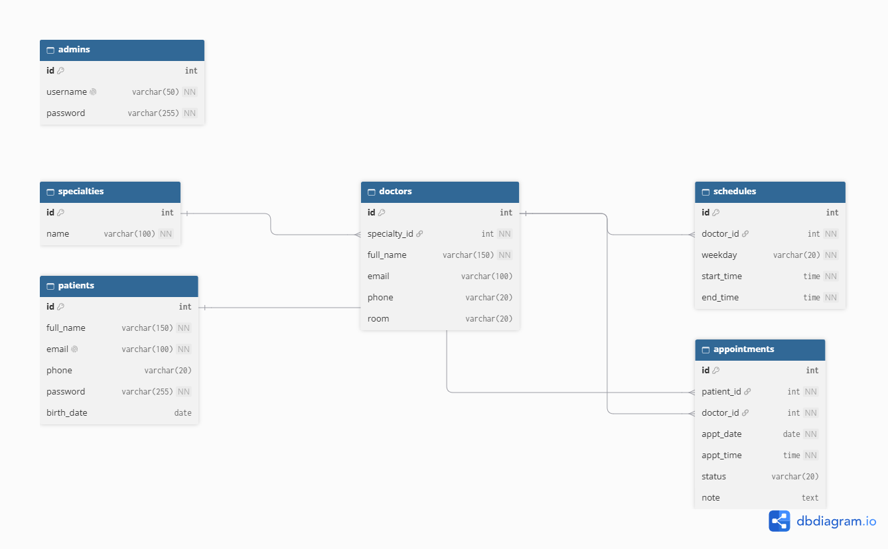

# Dr.tirkelu — дәрігерге жазылу жүйесі

PHP және MySQL қолданып жасалып жатқан веб-қосымша. Пациенттер дәрігерлер тізімін көріп, өздеріне ыңғайлы күн мен уақытқа қабылдауға онлайн жазыла алады. Әкімші (admin) дәрігерлерді, мамандықтарды және жазылуларды басқарады.

Жеке жобалық тапсырма, PHP курсы. Жоба 8 аптаға созылады (8–15 апта).

## Жобаның мақсаты
Емханадағы кезекті азайту және дәрігерге жазылу процесін автоматтандыру: дәрігерлер каталогын жүргізу, бос уақытқа жазылу, бір уақытқа екі рет жазылуға жол бермеу және жазылуларды басқару.

## Технологиялар
- **Frontend:** HTML, CSS, JavaScript
- **Backend:** PHP 8
- **Дерекқор:** MySQL
- **Орта:** XAMPP (Apache + PHP + MySQL)
- **Нұсқаларды басқару:** Git, GitHub

## Негізгі мүмкіндіктер
- Тіркелу, кіру және шығу (құпия сөздер `password_hash()` арқылы сақталады)
- Дәрігерлерді қосу, көрсету, өңдеу және жою (CRUD, тек admin)
- Дәрігерге бос күн мен уақытқа жазылу
- Бір дәрігерге бір уақытқа екі рет жазылуға жол бермеу
- Дәрігерді аты бойынша іздеу және мамандық бойынша сүзу
- Өз жазылуларын көру және бас тарту
- Рөлдер: `user` (пациент) және `admin` (әкімші)
- Валидация және қауіпсіздік (prepared statements, `htmlspecialchars()`)

## Беттер тізімі
| № | Бет | Файл | Сипаттамасы | Күйі |
|---|---|---|---|---|
| 1 | Басты бет | `index.php` | Жылдам жазылу блогы, мамандықтар | Дайын |
| 2 | Дәрігерлер | `doctors.php` | Дәрігерлер тізімі, іздеу және сүзу | Дайын |
| 3 | Кіру | `login.php` | Жүйеге кіру | Дайын |
| 4 | Тіркелу | `register.php` | Жаңа пациентті тіркеу | Дайын |
| 5 | Менің жазылуларым | `my_appointments.php` | Өз жазылулары, бас тарту | Жоспарда |
| 6 | Дәрігер қосу / өңдеу | `add_doctor.php`, `edit_doctor.php` | Дәрігерлермен CRUD (admin) | Жоспарда |
| 7 | Барлық жазылулар | `appointments.php` | Жазылуларды басқару (admin) | Жоспарда |

## Дерекқор құрылымы (ER-диаграмма)


Негізгі кестелер:
- `users` — пайдаланушылар (рөлі: `user` немесе `admin`).
- `specialties` — дәрігерлердің мамандықтары.
- `doctors` — дәрігерлер. Бір мамандықта көп дәрігер болады (1 : N).
- `appointments` — жазылулар. Бір пайдаланушыда көп жазылу болады, бір дәрігерде де көп жазылу болады (1 : N).

## Жоба құрылымы
```
├── index.php
├── doctors.php
├── login.php
├── register.php
├── includes/
│   ├── header.php
│   ├── footer.php
│   ├── functions.php
│   └── data.php
├── css/
│   └── style.css
├── js/
│   └── script.js
└── er-diagram.png
```

## Жоба жоспары
| Апта | Тақырып | Нәтиже |
|---|---|---|
| 8 | Жоспарлау және репозиторий | README, беттер тізімі, ER-диаграмма |
| 9 | Frontend | Кемінде 3 статикалық бет |
| 10 | PHP негіздері | PHP беттері, жұмыс істейтін форма |
| 11 | Дерекқор және аутентификация | Тіркелу, кіру, шығу |
| 12 | CRUD | Дәрігерлермен толық CRUD |
| 13 | Мәліметтермен жұмыс | Іздеу, сүзу, сұрыптау, жазылу логикасы |
| 14 | Қосымша функция және қауіпсіздік | Қосымша функция, қауіпсіздік тексерісі |
| 15 | Тестілеу, хостинг, қорғау | Жоба, есеп, қорғау |

## Апталық есептер

### 8-апта: Жоспарлау және репозиторий
**Орындалған жұмыс**
- Жоба тақырыбы таңдалды: Dr.tirkelu, дәрігерге жазылу жүйесі. Мақсаты мен негізгі мүмкіндіктері сипатталды.
- Беттер мен функциялар тізімі жасалды.
- Дерекқор құрылымы (ER-диаграмма) сызылды.
- GitHub-та репозиторий ашылды, README жазылды.

**Жобаның күйі:** ~10%

**Мәселелер және шешімдері:** елеулі мәселе болған жоқ.

**Келесі аптаға жоспар:** HTML, CSS және JavaScript арқылы интерфейсті іске асыру.

[GitHub: коммиттер тарихы](https://github.com/aiasylzhubanazar-oss/dr.appointment.systemm/commits/main)

### 9-апта: Пайдаланушы интерфейсі (frontend)
**Орындалған жұмыс**
- HTML, CSS және JavaScript көмегімен адаптивті интерфейс іске асырылды: басты бет, дәрігерлер беті, кіру және тіркелу формалары.
- Түстер палитрасы таңдалды: қанық көк, ақ және қара.
- JavaScript арқылы бургер мәзір, бос уақыт слотын таңдау, құпия сөзді көрсету/жасыру, форманың клиенттік валидациясы және дәрігерлерді іздеу мен сүзу жасалды.
- Телефон, планшет және компьютер экрандарына арналған адаптивті стильдер қосылды (`@media`).

**Жобаның күйі:** ~25%

**Мәселелер және шешімдері:** елеулі мәселе болған жоқ.

**Келесі аптаға жоспар:** беттерді PHP файлдарына көшіру, `include` арқылы header/footer бөлу, формаларды өңдеу.

[GitHub: коммиттер тарихы](https://github.com/aiasylzhubanazar-oss/dr.appointment.systemm/commits/main)

### 10-апта: PHP негіздері және серверлік құрылым
**Орындалған жұмыс**
- Статикалық беттер PHP-ге көшірілді: `index.php`, `doctors.php`, `login.php`, `register.php`.
- Қайталанатын бөліктер `include` арқылы бөлінді: `includes/header.php`, `includes/footer.php`. Уақытша дәрігерлер тізімі `includes/data.php` ішінде, көмекші функциялар `includes/functions.php` ішінде.
- Дәрігерлерді іздеу және мамандық бойынша сүзу `$_GET` арқылы жұмыс істейді.
- Тіркелу және кіру формалары `$_POST` арқылы өңделеді, деректер сервер жағында тексеріледі (аты, телефон, email, құпия сөз).
- Экранға шығатын мәтін `htmlspecialchars()` арқылы қорғалды (XSS).
- Жоба XAMPP (Apache) арқылы `localhost` мекенжайында тексерілді.

**Жобаның күйі:** ~40%

**Мәселелер және шешімдері**
- PHP файлы қос шерту арқылы (`file:///`) жұмыс істемейді, оны `http://localhost/...` арқылы ашу керек екенін түсіндім.
- Жоба папкасы `htdocs` ішінде тұрмағандықтан, сайт "Not Found" қатесін көрсетті. Папканы `C:\xampp\htdocs\` ішіне көшіріп шештім.
- GitHub-қа папканың өзін жүктегенде файлдар ішкі папкаға түсіп кетті. Папканың ішіндегі файлдарды жүктеп түзеттім.

**Келесі аптаға жоспар:** MySQL дерекқорын құру, PDO арқылы қосылу, тіркеуде `password_hash()`, кіру жүйесі және сессиялар, шығу (logout).

[GitHub: коммиттер тарихы](https://github.com/aiasylzhubanazar-oss/dr.appointment.systemm/commits/main)


## Автор
Айасыл Жұбаназар
